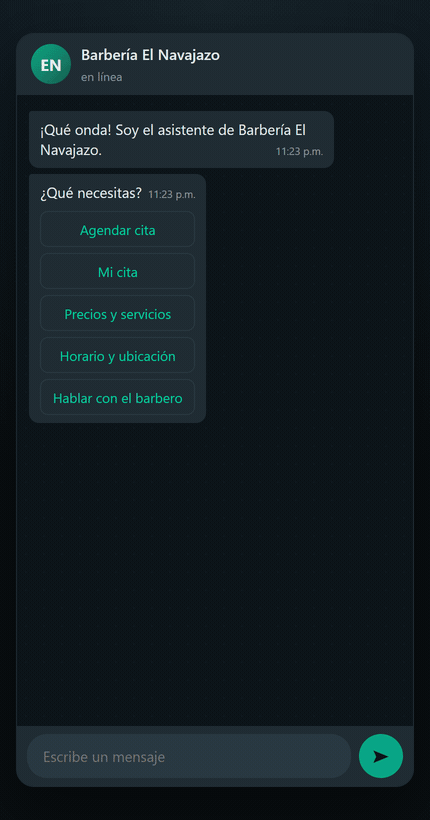
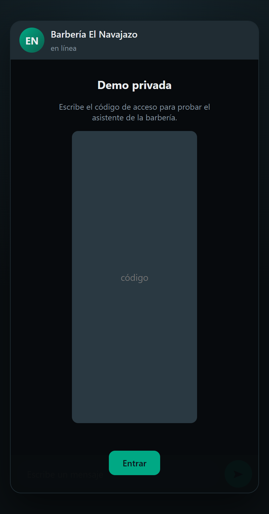
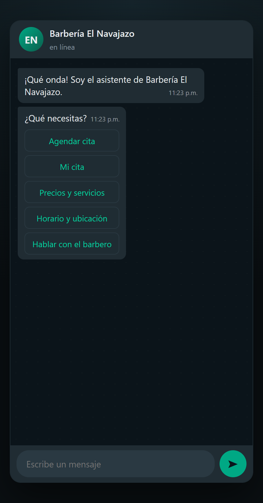
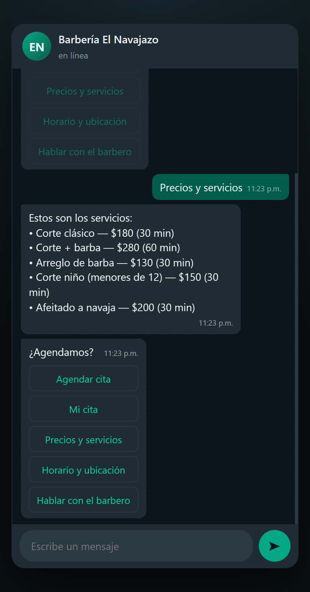
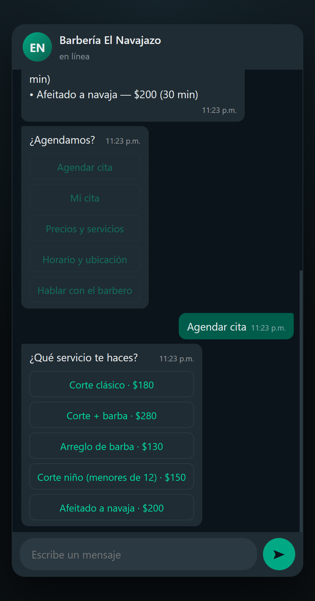
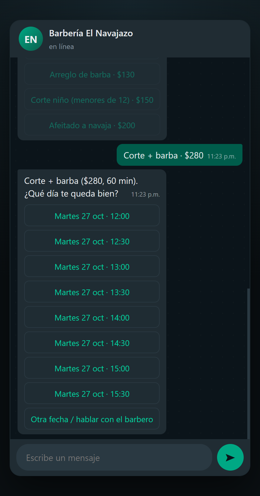
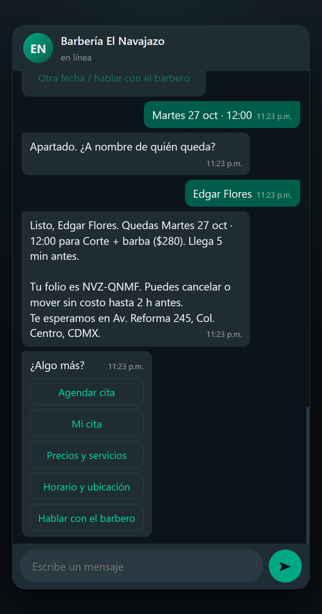

# Ambar — bot de WhatsApp (demo)

[](https://github.com/EdgeFlores19/barberia-bot/actions/workflows/tests.yml)

**Demo en vivo:** <https://navajazo-bot.onrender.com> · el código de acceso se da bajo petición
*(plan Starter: el servicio no se duerme; la primera carga tras un deploy puede tardar unos segundos)*

Asistente conversacional para un estudio de uñas en Aguascalientes: responde preguntas frecuentes, agenda citas
y pasa la conversación a una persona cuando hace falta. Es un **proyecto muestra**: no está
conectado a un número de WhatsApp del negocio (solo al número de prueba de Meta, que únicamente
atiende a personas con rol en la app), y se usa desde un chat web con la estética de WhatsApp.

> **Negocio ficticio.** Nombre, dirección (Av. Francisco I. Madero 328, Col. Centro, Aguascalientes),
> teléfono, precios y servicios son inventados. Todos los datos viven en `data/barberia.json` y se
> editan sin tocar código. El nombre técnico del repo y de los archivos (`barberia-bot`,
> `barberia.json`, `barberia.db`) se conserva a propósito para no romper rutas, CI ni el servicio en Render.



## Qué hace (v1)

- **FAQ**: precios, servicios, horario, ubicación, formas de pago, estacionamiento.
- **Agendar**: servicio → día/hora → nombre → confirmación. Slots de 30 min, hasta 7 días
  adelante, mínimo 1 hora de anticipación, sin dobles reservas.
- **Cancelar / reagendar** con el folio de la cita, libre hasta 2 h antes.
- **Hablar con la manicurista**: handoff y se registra en la conversación.

Cada cita confirmada recibe un **folio** legible por teléfono (`AMB-7K4Q`, sin `0/O` ni `1/I/L`).
Es la llave para ver, mover o cancelar la cita: en v1 no hay login.

## Capturas

| Acceso por código | Menú principal | Precios |
|---|---|---|
|  |  |  |

| Elegir servicio | Horarios reales | Cita con folio |
|---|---|---|
|  |  |  |

## Dónde viven las citas

- **SQLite es la fuente de verdad** (`barberia.db`, configurable con `DB_FILE`). Los horarios
  ocupados, los folios y los estados (`confirmada` / `cancelada`) salen de ahí.
- **Google Calendar es solo un espejo opcional.** Se activa con `GOOGLE_CALENDAR_ID` y
  `GOOGLE_TOKEN_JSON`; si el token expira o la API falla, el bot sigue agendando igual y lo
  anota en el log. Calendar no sabe de dobles reservas, así que nunca se usa para decidir
  disponibilidad.

Fuera de v1 a propósito: pagos, promociones, lealtad, multi-sucursal, multi-estilista,
recordatorios salientes 24 h antes y penalizaciones por cancelar.

## Cómo funciona el cerebro

Híbrido, con el LLM en un carril estrecho:

| Camino | Quién decide |
|---|---|
| Elegir servicio, día y hora | Botones y reglas deterministas (el LLM nunca inventa un horario) |
| FAQ y texto libre | DeepSeek redacta, **anclado** al JSON del negocio |
| Salida del LLM | `llm._guardia` la revisa: si inventa enlace, teléfono, monto, promesa o HTML, se descarta y contesta la respuesta local ([ADR 0005](docs/adr/0005-guardia-llm-prompt-injection.md)) |
| Sin `DEEPSEEK_API_KEY` o si la API falla | Matching local por tags; el bot sigue respondiendo |

## Arrancar en local

```bash
python -m venv .venv
.venv/Scripts/pip install -r requirements.txt      # Linux/macOS: .venv/bin/pip
cp .env.example .env                               # pon tu DEMO_CODE (obligatorio); DeepSeek es opcional
.venv/Scripts/python -m uvicorn app.main:app --reload --port 8077 --env-file .env
```

Abre <http://127.0.0.1:8077> y usa el código que pusiste en `DEMO_CODE` dentro de `.env`.
El servidor no arranca sin él (solo para desarrollo local: `ALLOW_OPEN_DEMO=1`).
La primera vez siembra dos citas de ejemplo (`SEED_DEMO=0` lo desactiva).

### Pruebas

```bash
.venv/Scripts/python -m pytest tests/ -q --ignore=tests/smoke_test.py   # 272 pruebas
.venv/Scripts/python tests/smoke_test.py                                # contra el servidor
```

`smoke_test.py` recorre código inválido → sesión → agendar → folio → reagendar → cancelar
→ FAQ y falla si algo se rompe. CI los corre en cada push: `.github/workflows/tests.yml`.

## Estructura

```
app/
  main.py      FastAPI: /, /health, /api/sesion, /api/mensaje, /api/negocio, /api/citas
  engine.py    motor conversacional determinista (máquina de estados + intenciones)
  llm.py       matching de FAQ local + capa DeepSeek opcional con fallback y guardia de salida
  slots.py     disponibilidad: horario del negocio, alto del servicio, huecos ocupados
  store.py     citas en SQLite: folio, doble reserva, cancelar y reagendar
  seed.py      citas de ejemplo cuando la agenda arranca vacía
  calendar_sync.py  espejo opcional a Google Calendar (best-effort, por REST)
  config.py    configuración por variables de entorno
data/
  barberia.json   negocio, horario, reglas de agenda, servicios, FAQ
static/
  index.html      chat web estilo WhatsApp (acceso por código)
tests/
  smoke_test.py   prueba end-to-end contra el servidor
  test_engine.py  agendar, folio, cancelar y reagendar
  test_slots.py   cálculo de disponibilidad
  test_seed.py    citas de ejemplo
render.yaml       blueprint del deploy (runtime python, sin Docker)
```

## Canal WhatsApp (opcional)

El motor es el mismo del chat web; el adaptador vive en `app/whatsapp_webhook.py`
y se puede probar sin cuenta de Meta:

```bash
WA_MODO=consola WA_VERIFY_TOKEN=prueba WA_APP_SECRET=prueba \
  uvicorn app.main:app --port 8077
python scripts/wa_simula.py "precios"
```

Con credenciales reales: webhook `https://<host>/wa/webhook`, campos `messages`,
y las variables `WA_VERIFY_TOKEN`, `WA_APP_SECRET`, `WA_TOKEN`, `WA_PHONE_ID`.

El canal está **encendido desde el 2026-11-01** (`WA_MODO=graph`): el webhook verifica la firma
HMAC de Meta, y `GET /health` publica el diagnóstico en vivo (`posts`, `eventos`, `envios_ok`,
`envios_fallidos`, `firma_rechazada`, `ultimo_codigo_envio`) sin guardar teléfonos ni texto de
clientes. Sin las variables `WA_*` el canal queda apagado y el `GET` del webhook responde 403.

Sigue siendo **canal de prueba**: el número es el de test de Meta y ambas funciones de WhatsApp
están en "Listo para prueba" (sin App Review no se atiende a clientes reales). El servicio ya corre
en plan Starter con disco persistente (ver [ADR 0006](docs/adr/0006-disco-persistente-starter.md)).
Lo que falta para operar de verdad está en los issues del repo.

### Decisiones de diseño

| ADR | Tema |
|---|---|
| [`0001`](docs/adr/0001-canal-whatsapp-cloud-api.md) | Canal WhatsApp Cloud API: adaptador aislado del motor (D1–D10) |
| [`0002`](docs/adr/0002-persistencia-disco-efimero.md) | SQLite efímera aceptada como demo y gatillo para reabrir |
| [`0003`](docs/adr/0003-marca-ambar.md) | La marca es **Ambar**: qué se renombra y qué se conserva |
| [`0004`](docs/adr/0004-datos-reales-solo-legales.md) | Datos reales del negocio solo en privacidad y condiciones |
| [`0005`](docs/adr/0005-guardia-llm-prompt-injection.md) | Guardia de entrada y salida del LLM contra prompt injection |
| [`0006`](docs/adr/0006-disco-persistente-starter.md) | Plan Starter con disco persistente: reemplaza la decisión del ADR 0002 |

## Deploy (Render, plan Starter)

El blueprint `render.yaml` define el servicio. Los secretos se capturan en el panel, nunca
en el repo:

| Variable | Valor |
|---|---|
| `DEMO_CODE` | código de acceso de la demo (obligatorio, sin valor por defecto) |
| `SESSION_SECRET` | lo genera Render (`generateValue`); firma los sid del chat web |
| `DEEPSEEK_API_KEY` | key dedicada con saldo bajo |
| `MAX_MENSAJES_POR_SESION` | `30` |
| `MAX_MENSAJES_POR_DIA` | `600` |
| `SEED_DEMO` | `1` |
| `DB_FILE` | `/var/data/ambar.db` (dentro del disco; si se omite, la base se pierde en cada deploy) |
| `GOOGLE_CALENDAR_ID` | vacío: el token de Calendar es personal y no se publica |

Qué cambió con el plan Starter y el disco:

1. **El servicio ya no duerme.** Antes, tras ~15 min sin tráfico, el primer webhook de Meta llegaba
   a un proceso dormido y la respuesta se perdía; ahora el proceso queda arriba.
2. **La base sobrevive.** SQLite vive en `/var/data` (disco de 1 GB, $0.25/mes), así que las citas
   agendadas en una prueba siguen ahí en el siguiente deploy. `SEED_DEMO` solo siembra cuando la
   agenda está vacía, de modo que no vuelve a meter citas de ejemplo encima de las reales.
3. **El costo del disco es el deploy con caída.** Con disco adjunto, Render no puede hacer deploys
   de cero-downtime: hay unos segundos fuera de línea en cada deploy. Aceptable para un bot; no lo
   hagas en hora pico.
4. **El plan se declara en el blueprint.** `render.yaml` dice `plan: starter` a propósito: si dijera
   `free`, el siguiente sync intentaría bajar el servicio y Render **borra el disco** al hacerlo.

## Controles de acceso (es una demo pública)

1. `DEMO_CODE` como primera pantalla.
2. Presupuesto duro de mensajes: 30 por sesión, 600 por día, con contador en memoria/SQLite que pausa el bot.
3. Key de DeepSeek dedicada con saldo bajo, para que el techo de gasto sea real.
4. El texto del LLM no sale sin pasar por la guardia de `app/llm.py`: pregunta delimitada y
   recortada, y respuesta descartada si inventa enlace, teléfono, monto o promesa. El modelo no
   tiene herramientas: no puede agendar ni cancelar. Detalle y límites en el
   [ADR 0005](docs/adr/0005-guardia-llm-prompt-injection.md).

## Roadmap

- **F1 (hecho)**: datos + FAQ + chat local funcionando.
- **F2 (hecho)**: agenda en SQLite con folio, cancelar/reagendar y sync opcional a Google Calendar.
- **F3 (hecho)**: repo público, CI, capturas y deploy en Render.
- **F4 (hecho)**: canal WhatsApp Cloud API sobre el mismo motor, con `/privacidad` y `/terminos`.
- **F5 (pendiente)**: operar con clientes reales — verificación de negocio y App Review de Meta,
  disco persistente y `SEED_DEMO=0`.
