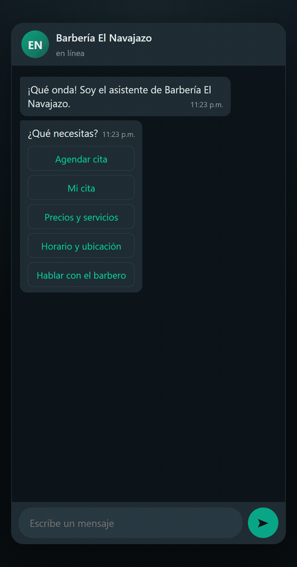
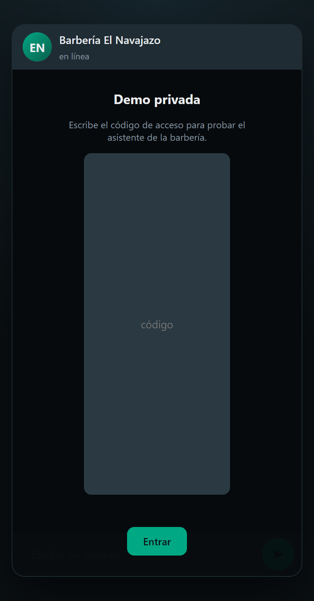
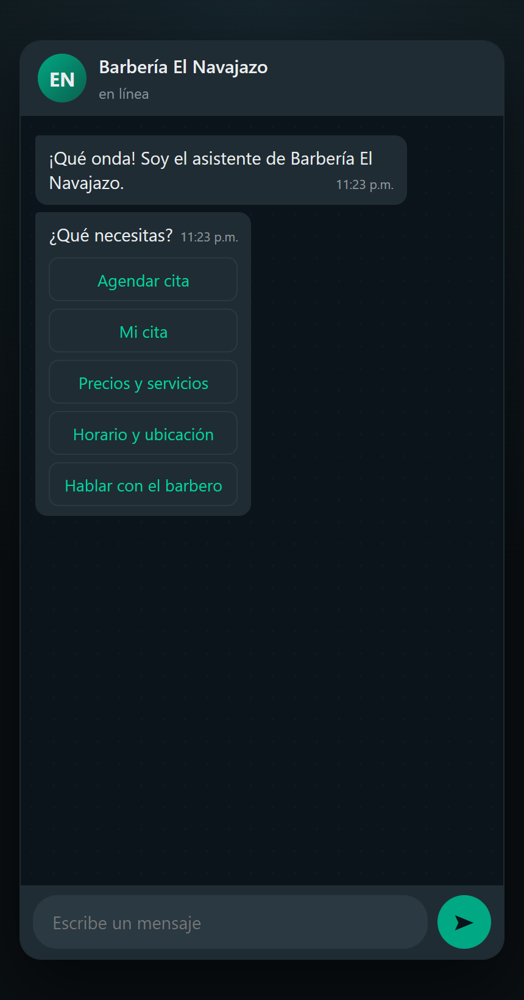
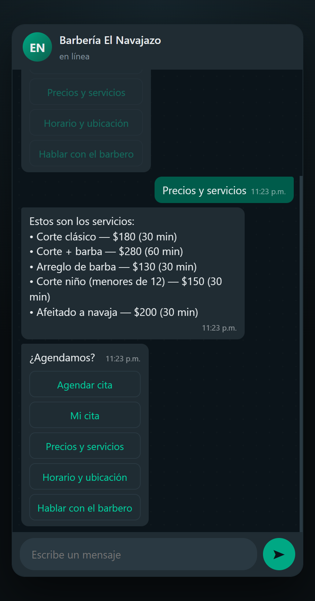
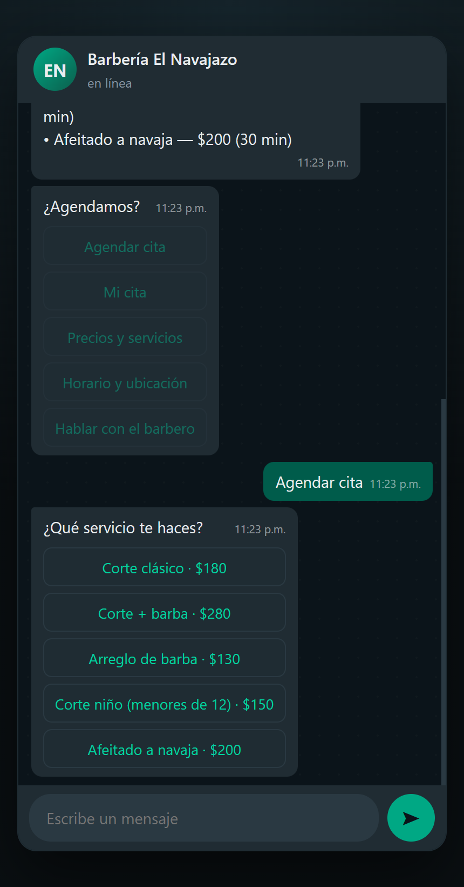
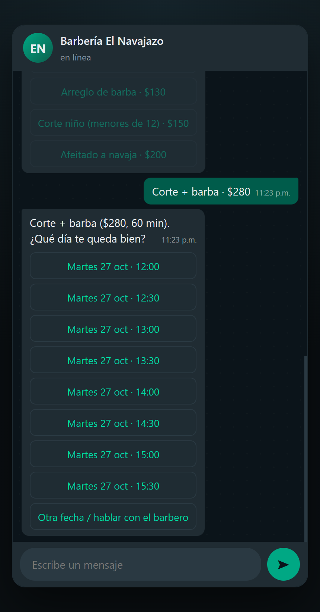
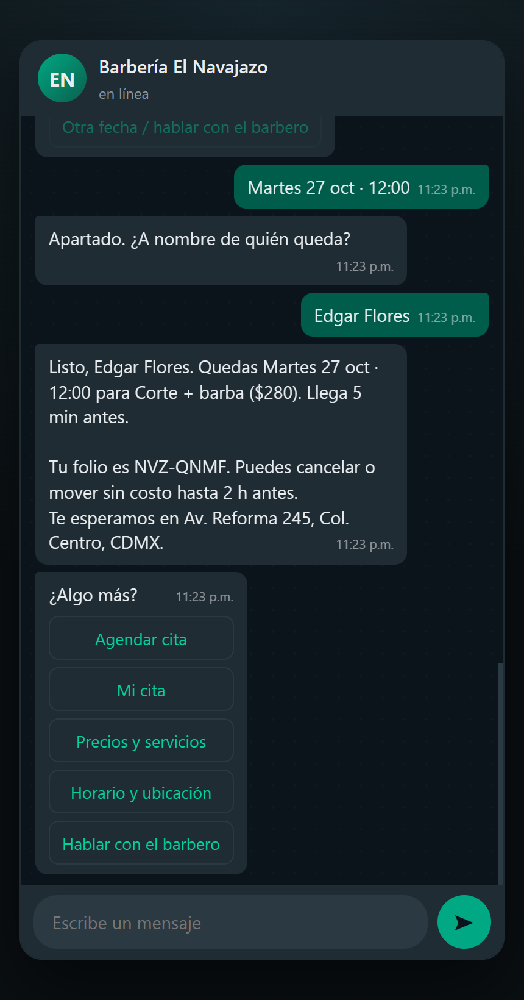

# Barbería El Navajazo — bot de WhatsApp (demo)

[](https://github.com/EdgeFlores19/barberia-bot/actions/workflows/tests.yml)

Asistente conversacional para una barbería: responde preguntas frecuentes, agenda citas
y pasa la conversación a una persona cuando hace falta. Es un **proyecto muestra**: no está
conectado a un número real de WhatsApp, se usa desde un chat web con la estética de WhatsApp.

> Barbería ficticia. Todos los datos viven en `data/barberia.json` y se editan sin tocar código.



## Qué hace (v1)

- **FAQ**: precios, servicios, horario, ubicación, formas de pago, estacionamiento.
- **Agendar**: servicio → día/hora → nombre → confirmación. Slots de 30 min, hasta 7 días
  adelante, mínimo 1 hora de anticipación, sin dobles reservas.
- **Cancelar / reagendar** con el folio de la cita, libre hasta 2 h antes.
- **Hablar con el barbero**: handoff y se registra en la conversación.

Cada cita confirmada recibe un **folio** legible por teléfono (`NVZ-7K4Q`, sin `0/O` ni `1/I/L`).
Es la llave para ver, mover o cancelar la cita: en v1 no hay login.

## Capturas

| Acceso por código | Menú principal | Precios |
|---|---|---|
|  |  |  |

| Elegir servicio | Horarios reales | Cita con folio |
|---|---|---|
|  |  |  |

## Dónde viven las citas

- **SQLite es la fuente de verdad** (`barberia.db`, configurable con `DB_FILE`). Los horarios
  ocupados, los folios y los estados (`confirmada` / `cancelada`) salen de ahí.
- **Google Calendar es solo un espejo opcional.** Se activa con `GOOGLE_CALENDAR_ID` y
  `GOOGLE_TOKEN_JSON`; si el token expira o la API falla, el bot sigue agendando igual y lo
  anota en el log. Calendar no sabe de dobles reservas, así que nunca se usa para decidir
  disponibilidad.

Fuera de v1 a propósito: pagos, promociones, lealtad, multi-sucursal, multi-barbero,
recordatorios salientes 24 h antes y penalizaciones por cancelar.

## Cómo funciona el cerebro

Híbrido, con el LLM en un carril estrecho:

| Camino | Quién decide |
|---|---|
| Elegir servicio, día y hora | Botones y reglas deterministas (el LLM nunca inventa un horario) |
| FAQ y texto libre | DeepSeek redacta, **anclado** al JSON de la barbería |
| Sin `DEEPSEEK_API_KEY` o si la API falla | Matching local por tags; el bot sigue respondiendo |

## Arrancar en local

```bash
python -m venv .venv
.venv/Scripts/pip install -r requirements.txt      # Linux/macOS: .venv/bin/pip
cp .env.example .env                               # opcional: clave DeepSeek
.venv/Scripts/python -m uvicorn app.main:app --reload --port 8077
```

Abre <http://127.0.0.1:8077> y usa el código de acceso `navajazo` (configurable en `DEMO_CODE`).
La primera vez siembra dos citas de ejemplo (`SEED_DEMO=0` lo desactiva).

### Pruebas

```bash
.venv/Scripts/python -m pytest tests/ -q --ignore=tests/smoke_test.py   # 54 pruebas
.venv/Scripts/python tests/smoke_test.py                                # contra el servidor
```

`smoke_test.py` recorre código inválido → sesión → agendar → folio → reagendar → cancelar
→ FAQ y falla si algo se rompe. CI los corre en cada push: `.github/workflows/tests.yml`.

## Estructura

```
app/
  main.py      FastAPI: /, /health, /api/sesion, /api/mensaje, /api/negocio, /api/citas
  engine.py    motor conversacional determinista (máquina de estados + intenciones)
  llm.py       matching de FAQ local + capa DeepSeek opcional con fallback
  slots.py     disponibilidad: horario del negocio, alto del servicio, huecos ocupados
  store.py     citas en SQLite: folio, doble reserva, cancelar y reagendar
  seed.py      citas de ejemplo cuando la agenda arranca vacía
  calendar_sync.py  espejo opcional a Google Calendar (best-effort, por REST)
  config.py    configuración por variables de entorno
data/
  barberia.json   negocio, horario, reglas de agenda, servicios, FAQ
static/
  index.html      chat web estilo WhatsApp (acceso por código)
tests/
  smoke_test.py   prueba end-to-end contra el servidor
  test_engine.py  agendar, folio, cancelar y reagendar
  test_slots.py   cálculo de disponibilidad
  test_seed.py    citas de ejemplo
render.yaml       blueprint del deploy (runtime python, sin Docker)
```

## Deploy (Render, plan free)

El blueprint `render.yaml` define el servicio. Los secretos se capturan en el panel, nunca
en el repo:

| Variable | Valor |
|---|---|
| `DEMO_CODE` | código de acceso de la demo |
| `DEEPSEEK_API_KEY` | key dedicada con saldo bajo |
| `MAX_MENSAJES_POR_SESION` | `15` |
| `MAX_MENSAJES_POR_DIA` | `200` |
| `SEED_DEMO` | `1` |
| `GOOGLE_CALENDAR_ID` | vacío: el token de Calendar es personal y no se publica |

Dos cosas honestas del plan free:

1. **El servicio duerme** tras ~15 min sin tráfico; el primer mensaje tarda unos segundos en despertarlo.
2. **No hay disco persistente**: cada reinicio crea una base nueva y siembra las dos citas de
   ejemplo. Los folios creados en la demo no sobreviven al reinicio. Para citas duraderas haría
   falta un plan con disco o Postgres.

## Controles de acceso (es una demo pública)

1. `DEMO_CODE` como primera pantalla.
2. Presupuesto duro de mensajes: 15 por sesión, 200 por día, con contador en SQLite que pausa el bot.
3. Key de DeepSeek dedicada con saldo bajo, para que el techo de gasto sea real.

## Roadmap

- **F1 (hecho)**: datos + FAQ + chat local funcionando.
- **F2 (hecho)**: agenda en SQLite con folio, cancelar/reagendar y sync opcional a Google Calendar.
- **F3 (hecho)**: repo público, CI, capturas y deploy en Render.
- Fuera de alcance: adaptador real de WhatsApp Cloud API (el motor ya está aislado detrás de una
  interfaz para conectarlo después).
